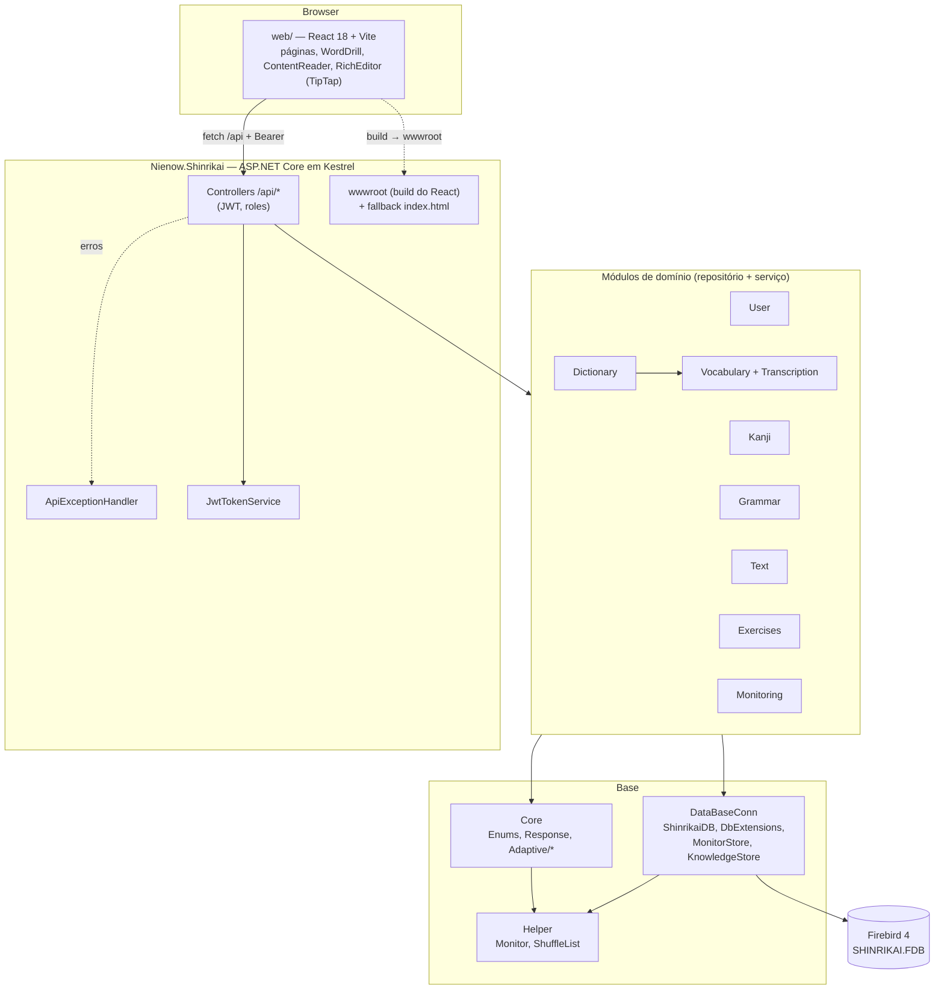
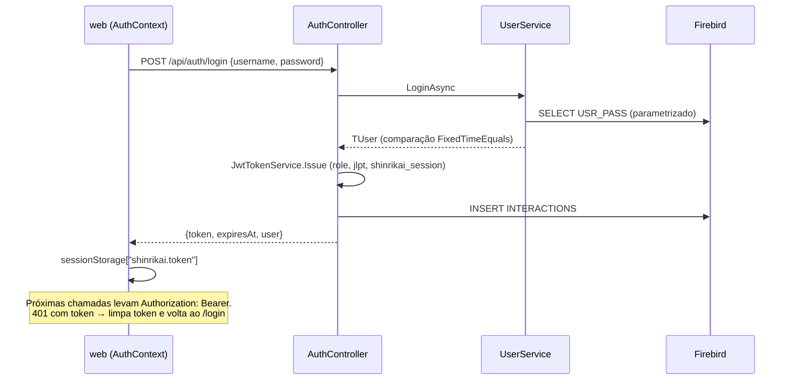
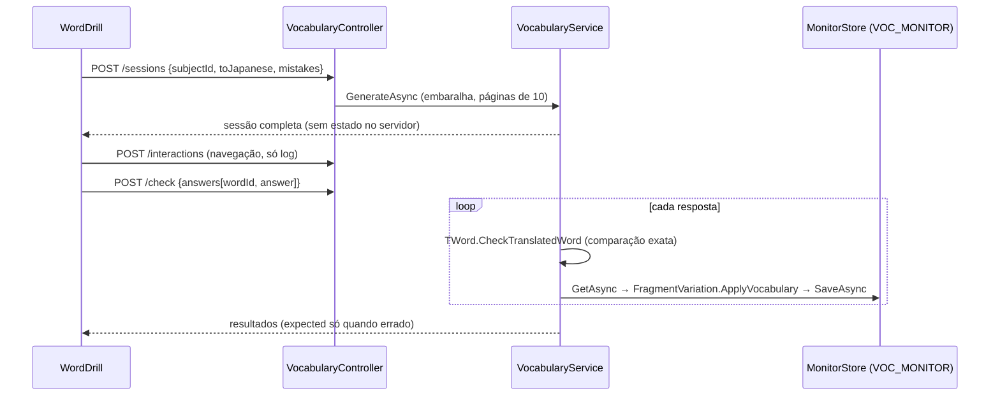
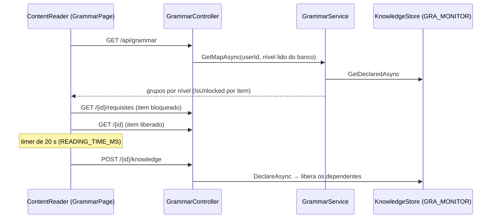

# Codebase Map

> Gerado pelo Cartographer. Último mapeamento: 2026-11-04T13:40:20Z.
> Contagem de tokens estimada (bytes ÷ 4) sobre os arquivos rastreados, sem `package-lock.json` e imagens.

O Shinrikai é o sistema hipermídia adaptativa para estudo de japonês do TCC de Éverton C. M. Nienow (UCS).
Esta é a versão portada de ASP.NET MVC 5 / .NET Framework 4.5 / IIS para **.NET 10 (API em Kestrel) +
React**, mantendo o banco **Firebird**. O valor acadêmico está nas 4 técnicas de adaptatividade de
`Nienow.Shinrikai.Core/Adaptive`, testadas 1:1 contra cópias literais do código original.

## Visão geral do sistema



## Estrutura de diretórios

```
Nienow.Shinrikai.sln            solution (12 projetos + pasta tests)
Directory.Build.props           net10.0, Nullable on, ImplicitUsings OFF, LangVersion latest
global.json                     SDK 10.0.100, rollForward latestFeature
.editorconfig                   namespaces em bloco, usings fora do namespace, System primeiro
Nienow.Helper/                  Monitor (POCO de contadores), ExtensionMethods (ShuffleList, CleanText, ToByteArray)
Nienow.Shinrikai.Core/          Enums.cs (EJLPT, EMode, ESex, Response) + Adaptive/ (algoritmos puros)
Nienow.DataBaseConn/            conexão Firebird, helpers ADO.NET parametrizados, stores de monitor/conhecimento
Nienow.Shinrikai.User/          UserModule.cs — login, cadastro, papéis, notificações de ajuda
Nienow.Shinrikai.Vocabulary/    TWord, VocabularyRepository/Service, TranscriptionModule
Nienow.Shinrikai.Kanji/         KanjiModule.cs
Nienow.Shinrikai.Grammar/       GrammarModule.cs — mapa adaptativo
Nienow.Shinrikai.Text/          TextModule.cs — leitura com stretchtext
Nienow.Shinrikai.Exercises/     ExercisesModule.cs — ordenação adaptativa
Nienow.Shinrikai.Dictionary/    DictionaryModule.cs — busca em memória sobre o vocabulário
Nienow.Shinrikai.Monitoring/    MonitoringService.cs — log INTERACTIONS (dados da pesquisa)
Nienow.Shinrikai/               API: Program.cs, Controllers/, Auth/, ApiExceptionHandler, appsettings*
tests/Nienow.Shinrikai.Tests/   xUnit; Legacy/ = cópias literais do código original (oráculo)
web/                            front React + Vite + TipTap (build vai para Nienow.Shinrikai/wwwroot)
database/                       schema.sql, seed.sql e scripts PowerShell (criar, conectar, promover)
.github/workflows/build.yml     CI: build, testes, Sonar (não bloqueante), build do web
.claude/launch.json             servidores de preview: API :5080 e web :5173
```

## Guia dos módulos

### Grafo de dependências

```
Helper            (sem referências)
Core              → Helper
DataBaseConn      → Helper   (+ FirebirdSql.Data.FirebirdClient 10.3.4, Microsoft.Extensions.Options)
User, Vocabulary, Kanji, Grammar, Text, Exercises, Monitoring → DataBaseConn, Core
Dictionary        → Core, Vocabulary     (único módulo de domínio que referencia outro)
Nienow.Shinrikai  → todos os anteriores  (+ JwtBearer 10.0.12, Swashbuckle 10.3.1)
Tests             → Core, Vocabulary, User, Kanji, Grammar, Text, Exercises, Dictionary
```

### Nienow.Helper

| Arquivo | Propósito | Tokens |
|---|---|---|
| `Monitor.cs` | POCO de contadores por usuário/item: `ID, UsrID, VcbID, FailCounter, Counter, SuccessCounter, LastHittedTime`; `IsNew => ID == -1` | 258 |
| `ExtensionMethods.cs` | `ShuffleList` (Fisher-Yates, `Random` injetável), `CleanText`, `ToByteArray` | 388 |

O nome `Monitor` colide com `System.Threading.Monitor`: todo arquivo que o usa declara
`using Monitor = Nienow.Helper.Monitor;`.

### Nienow.Shinrikai.Core

| Arquivo | Propósito | Tokens |
|---|---|---|
| `Enums.cs` | `EJLPT {None, N5..N1}`, `EMode`, `ESex`, `Response {OK, Message; Ok(), Fail()}` | 164 |
| `Adaptive/JlptLevel.cs` | `HasEnoughLevel(user, content, restrict)` = `content <= user + (restrict ? 0 : 1)` | 241 |
| `Adaptive/FragmentVariation.cs` | Técnica 4.1: contadores de vocabulário, kanji, transcrição, stretchtext, exercícios | 911 |
| `Adaptive/AdaptiveMap.cs` | Técnica 4.2: pré-requisitos de gramática, 20 s para declarar conhecimento | 652 |
| `Adaptive/Stretchtext.cs` | Técnica 4.3: notação `漢字「かんじ」`→`<ruby>`, esconder `<rt>` de palavras conhecidas | 995 |
| `Adaptive/AdaptiveOrdering.cs` | Técnica 4.4: filtra exercícios por nível e embaralha; `AllExercisesTake = 10` | 299 |

**Regras exatas** (copiadas do original, ver testes):
- `FragmentVariation.Apply`: no acerto, se `Counter <= limiar` então `Counter = 0`, `SuccessCounter++` e
  `LastHittedTime = agora`; senão `Counter--`. No erro, se `Counter <= 0` então `FailCounter++`, e sempre
  `Counter = 10`.
  - Limiar 1 em vocabulário e kanji, limiar **0** em transcrição (quirk do original).
  - `RegisterLackOfKnowledge`: `FailCounter++` só se `Counter == 0`, e então `Counter = 10`.
  - `ApplyExercise`: só acumula sucesso/falha, não usa `Counter`.
- `AdaptiveMap.IsUnlocked` = `HasEnoughLevel(restrict) || (hasKnowledge && HasEnoughLevel(não restrito))`.
  `HasKnowledge` compara a quantidade declarada com `raw.Split(';').Length`.
- `Stretchtext.ShouldHideFurigana(counter)` = `counter is null || counter == 0`.

### Nienow.DataBaseConn

| Arquivo | Propósito | Tokens |
|---|---|---|
| `ShinrikaiDB.cs` | `IShinrikaiDb.OpenAsync`, `DbExtensions` (Command, QueryAsync, ScalarAsync, ExecuteInTransactionAsync, Get*, InClause), `DatabaseUnavailableException` + `Explain()` | 2235 |
| `MonitorStore.cs` | `IMonitorStore` (contadores VOC/TRL/KAN/EXE_MONITOR) e `IKnowledgeStore` (conhecimento declarado em GRA/TEX_MONITOR) | 2358 |

- Cada operação abre uma `FbConnection` nova (o pool é do driver); cada escrita é uma transação própria.
- Parâmetros sempre como tuplas `("@NOME", valor)`. Só nomes de tabela e coluna vindos de conjuntos
  fechados são interpolados.
- `GetNullableString` faz `TrimEnd()`, porque `CHAR` do Firebird vem com espaços à direita.
- Connection string vazia ou com `CONFIGURE_ME` lança `DatabaseUnavailableException`, que a API
  transforma em 503.

**Tabelas de monitor** (registro `MonitorTable` / `KnowledgeTable`):

| Tabela | Prefixo | Coluna do item | Generator | Observação |
|---|---|---|---|---|
| `VOC_MONITOR` | `VMN_` | `VMN_VCB_ID` | `VOCMONITOR_ID_GEN` | vocabulário |
| `TRL_MONITOR` | `TMN_` | `TMN_VCB_ID` | `TRLCMONITOR_ID_GEN` | transcrição **e** palavras do stretchtext |
| `KAN_MONITOR` | `KMN_` | `KMN_KNJ_ID` | `KANMONITOR_ID_GEN` | kanji |
| `EXE_MONITOR` | `EMN_` | `EMN_EXR_ID` | `EXEMONITOR_ID_GEN` | exercícios, sem coluna de contador |
| `GRA_MONITOR` | `GMN_` | `GMN_GRM_ID` | `GRAMONITOR_ID_GEN` | conhecimento declarado (gramática) |
| `TEX_MONITOR` | `TMN_` | `TMN_TXT_ID` | `TEXMONITOR_ID_GEN` | conhecimento declarado (texto) |

### Módulos de domínio

Todos seguem o mesmo padrão: um arquivo `*Module.cs` com modelos (`T*` = linha do banco), interface e
classe do repositório (só SQL) e serviço (regras e validação, com `TimeProvider` e `Random` injetáveis).
A lógica pura fica em métodos estáticos (`BuildSession`, `BuildMap`, `BuildList`, `Check`, `Validate`),
que são o que os testes cobrem.

| Módulo | Arquivo principal | Tabelas | Pontos-chave |
|---|---|---|---|
| User | `UserModule.cs` (2664) | USERS, NOTIFICATIONS, NOT_STATUS | `Roles.FromUserType`: A=Administrator, T=Teacher, resto=Student; `ContentEditors = "Administrator,Teacher"`; senha em texto puro comparada com `FixedTimeEquals`; cadastro nunca define papel; `MinPasswordLength = 5` |
| Vocabulary | `VocabularyRepository.cs` (2883), `VocabularyService.cs` (1884), `Model/TWord.cs` (1692) | VOCABULARY, SUBJECTS, VOC_MONITOR | palavra com até 3 "formas" (kanji, assunto, traduções separadas por vírgula, imagem, áudio); sessão inteira em páginas de 10 vai ao cliente; correção por ID no servidor, comparação exata |
| Transcription | `TranscriptionModule.cs` (2445) | VOCABULARY, TRL_MONITOR | só palavras com kanji no assunto; limiar 0; `SearchKanjiWordAsync` (até 10) alimenta o editor de textos |
| Kanji | `KanjiModule.cs` (3821) | KANJI, KAN_MONITOR | `CheckReading` soma bits 1/2/4, leitura repetida não conta; até 3 campos; níveis cumulativos (N1 = todos, inclusive sem nível); `Normalize` grava em maiúsculas |
| Grammar | `GrammarModule.cs` (3066) | GRAMMAR, GRA_MONITOR, EXERCISES (leitura) | `GRM_REQUISITES` = `"001;002;010"`; nível nulo = N5; mapa agrupado por nível com desbloqueados primeiro |
| Text | `TextModule.cs` (2293) | TEXTS, TEX_MONITOR, TRL_MONITOR, EXERCISES (leitura) | `GetForReadingAsync` converte a notação antiga e esconde furigana conforme `TRL_MONITOR`; clique na palavra → `RegisterLackOfKnowledge` |
| Exercises | `ExercisesModule.cs` (2821) | EXERCISES, EXE_MONITOR | `ExerciseQuestion` **não** leva a resposta certa; lista geral exclui exercícios de texto e pega 10; mensagem de erro cita o texto da opção |
| Dictionary | `DictionaryModule.cs` (923) | VOCABULARY, SUBJECTS (via `IVocabularyRepository`) | carrega todo o vocabulário e busca em memória; ordem exato → prefixo → contém; sensível a maiúsculas |
| Monitoring | `MonitoringService.cs` (489) | INTERACTIONS | log de pesquisa por tela/ação/opção; falhas viram warning e nunca derrubam a requisição |

### Nienow.Shinrikai (API)

| Arquivo | Propósito | Tokens |
|---|---|---|
| `Program.cs` | Kestrel (endpoints da config, 20 MB de corpo), proxy reverso opcional, DI, JWT, Swagger (só Development), arquivos estáticos + fallback SPA | 2051 |
| `ApiExceptionHandler.cs` | `DatabaseUnavailableException` → 503 com explicação; demais → 500 (detalhe só em Development) | 563 |
| `Auth/JwtTokenService.cs` | `JwtOptions`, emissão HMAC-SHA256 (480 min), claims `jlpt` e `shinrikai_session`, `User.UserId()/Jlpt()/SessionId()` | 874 |
| `Controllers/*.cs` | 9 controllers, 40 endpoints; cada um tem um `Log` que grava em INTERACTIONS | ~7.800 |
| `appsettings*.json`, `Properties/launchSettings.json` | Kestrel `http://localhost:5080`, `ReverseProxy:Enabled`, `Jwt:*`, connection string (perfil `Shinrikai`) | ~300 |

**DI:** `TimeProvider`, `IShinrikaiDb`, `JwtTokenService`, `IMonitorStore` e `IKnowledgeStore` são
singletons. Repositórios e serviços são scoped. Enums trafegam como string (`JsonStringEnumConverter`).

**Endpoints** (todos sob `/api`; `[Authorize]` exceto login e signup; **Ed** = Administrator ou Teacher):

| Controller | Endpoints |
|---|---|
| `auth` | `POST login`, `POST signup` (anônimos); `GET me`; `POST logout` (só registra a interação) |
| `vocabulary` | `GET subjects`; `POST sessions`; `POST check` (1–10 respostas); `POST interactions`; `GET words/{id}/{image\|audio}/{1-3}`; Ed: `GET words/{id}`, `GET words?kana=`, `POST words` (multipart) |
| `transcription` | `GET subjects`; `POST sessions`; `POST check`; `POST interactions`; `GET kanji-words?term=` |
| `kanjis` | `POST sessions`; `POST check`; `POST interactions`; `GET {id}/image`; Ed: `GET ?letter=`, `POST /` (multipart) |
| `grammar` | `GET /` (mapa); `GET {id}`; `GET {id}/requisites`; `POST {id}/knowledge`; Ed: `GET all?jlpt=`, `GET {id}/edit`, `POST /` |
| `texts` | `GET /`; `GET {id}` (furigana adaptada); `POST {id}/knowledge`; `POST words/{wordId}/lack-of-knowledge`; Ed: `GET {id}/edit`, `POST /` |
| `exercises` | `GET ?grammarId=&textId=` (ids); `GET {id}`; `POST {id}/check`; Ed: `GET edit?id=&grammarId=&textId=`, `POST /` |
| `dictionary` | `POST interactions`; `GET search?term=&type=General\|Japanese\|Portuguese` |
| `notifications` | `GET {id}?force=`; `POST {id}/understood` (ids de ajuda: 1 transcrição, 3 gramática, 4 texto, 5 exercícios, 6 vocabulário, 7 kanji) |

### web/ (React)

| Área | Arquivos | Tokens |
|---|---|---|
| Entrada e shell | `main.tsx`, `App.tsx` (rotas, `RequireAuth`, cabeçalho, menus Aluno/Professor), `menu.ts` | ~1.700 |
| API e auth | `api/client.ts` (`api<T>()`, token no `sessionStorage`, tratamento de 401), `api/types.ts` (DTOs), `auth/AuthContext.tsx` | ~1.750 |
| Componentes | `WordDrill` (vocabulário e transcrição), `ContentReader` (gramática e texto, timer de 20 s), `Dialogs` (alert/confirm/prompt/imagem), `Help` (notificações), `common` | ~5.700 |
| Editor | `RichEditor.tsx`, `extensions.ts` (nós `Furigana` e `VocabularyWord`), `fidelity.ts`, `VocabularyPicker.tsx` | ~5.600 |
| Páginas | 10 páginas de estudo/públicas + 5 de cadastro em `pages/register/` | ~14.600 |
| Estilo | `index.css`: folha global, variáveis CSS, tema escuro automático | 2.658 |

**Rotas:** `/`, `/sobre`, `/login` (públicas); `/transcricao`, `/vocabulario`, `/kanjis`, `/gramatica`,
`/textos`, `/exercicios`, `/dicionario` (autenticadas); `/professor/{gramatica,vocabulario,kanjis,textos,exercicios}`
(Administrator ou Teacher).

**Dev e build:** Vite na porta 5173 encaminha `/api` para `http://localhost:5080`. O `npm run build`
roda `tsc -b` e grava em `../Nienow.Shinrikai/wwwroot` com `emptyOutDir`.

### tests/

| Arquivo | O que verifica | Tokens |
|---|---|---|
| `Legacy/LegacyOracle.cs` | cópia literal dos algoritmos adaptativos originais (**não refatorar**) | 1820 |
| `Legacy/LegacyOracleModules.cs` | cópia literal da correção de kanji original | 604 |
| `AdaptiveAlgorithmsTests.cs` | equivalência 1:1 das 4 técnicas, enumerando todas as combinações | 2475 |
| `VocabularyServiceTests.cs` | paginação, correção, monitor, validações de palavra e usuário, papéis | 2276 |
| `ModulesTests.cs` | Kanji (1029 combinações vs. oráculo), Grammar, Text (fluxo de furigana), Exercises, Dictionary, Transcription | 4425 |

Os testes usam fakes escritos à mão (sem biblioteca de mock) e `Random` com seed. Nenhum teste precisa
de banco. Rodar: `dotnet test Nienow.Shinrikai.sln`; são 2641 testes.

### database/

| Arquivo | Propósito |
|---|---|
| `schema.sql` | 15 generators e 16 tabelas, reconstruídos a partir do SQL legado (Firebird 3/4/5, dialeto 3, UTF8) |
| `seed.sql` | notificações de ajuda 1, 3, 4, 5, 6, 7 e 11 assuntos de vocabulário (não cria usuários) |
| `create-database.ps1` | cria `database/data/SHINRIKAI.FDB` via `isql -i`, roda schema e seed, chama `configure-connection.ps1` |
| `configure-connection.ps1` | grava `ConnectionStrings__ShinrikaiDB` no perfil `Shinrikai` do `launchSettings.json` e em user-secrets |
| `promote-user.ps1` | define `USERS.USR_TYPE` (A, T ou nulo) de um login |

## Fluxos de dados

### Login e JWT



### Sessão de estudo (vocabulário; kanji e transcrição têm a mesma forma)



### Mapa adaptativo de gramática



### Leitura de texto com stretchtext

```mermaid
sequenceDiagram
    participant T as TextPage
    participant C as TextController
    participant S as TextService
    participant M as MonitorStore (TRL_MONITOR)
    T->>C: GET /api/texts/{id}
    C->>S: GetForReadingAsync
    S->>S: ConvertFuriganaNotation + ReferencedWordIds
    S->>M: GetCountersAsync(ids)
    S-->>T: HTML com <rt style="display: none;"> nas palavras conhecidas
    T->>T: clique no .stretchText com <rt> oculto
    T->>C: POST /texts/words/{data-id}/lack-of-knowledge
    C->>M: RegisterLackOfKnowledge (Counter = 10)
    T->>T: mostra a furigana
```

### Exercícios

`GET /api/exercises?grammarId|textId` devolve ids filtrados por nível e embaralhados (`AdaptiveOrdering`).
Depois, `GET /{id}` devolve a pergunta sem a resposta, e o front embaralha as opções.
`POST /{id}/check {answer}` compara com `EXR_RIGHT`, aplica `ApplyExercise` em `EXE_MONITOR` e devolve
`Response`; no erro, a mensagem cita o texto da opção correta.

## Convenções

- **C#:**
  - `ImplicitUsings` desligado: todo arquivo declara seus `using`, com `System.*` primeiro e fora do namespace.
  - Namespaces sempre em bloco (`namespace X { }`).
  - Primary constructors, classes `sealed`, records para DTOs.
  - Alias `using Monitor = Nienow.Helper.Monitor;`.
  - Nos controllers, `Core.Response` é qualificado, para não colidir com `ControllerBase.Response`.
- **Camadas:** controller fino → serviço (regras, `Response` para validação) → repositório (SQL). Erros de
  validação viram 400; exceções viram ProblemDetails no `ApiExceptionHandler`.
- **SQL:** sempre parametrizado com `@NOME`. As colunas têm prefixo de 3 letras por tabela (`USR_`, `VCB_`,
  `KNJ_`, `GRM_`, `TXT_`, `EXR_`…). IDs vêm de `GEN_ID(<generator>, 1)` dentro do INSERT, sem triggers.
- **Níveis JLPT:** gravados como string (`"N5"`) e lidos com `Enum.TryParse` ignorando caixa. Nulo é `None`,
  exceto em gramática e na listagem de textos, onde nulo vale N5.
- **Idioma:** comentários, mensagens e UI em português; ações de interação sem acento ("Pagina inicial").
- **Testes:** nomes em snake_case descritivo; theories com `MemberData` enumerando o espaço de entrada e
  comparando com o oráculo legado; fakes `private sealed class` dentro dos testes.
- **Front:**
  - Toda chamada passa por `api<T>()`.
  - Estado só local (`useState`); os únicos contextos são Auth e Dialogs.
  - Edição guiada por query string (`?id=`, `?grammarId=`, `?textId=`).
  - Todos os pacotes `@tiptap/*` fixados em 2.27.3, sem `^`.

## Pegadinhas

1. **Limiares diferentes por módulo** são intencionais (cópia do original). Na transcrição, acertar com
   `Counter == 1` só decrementa e não conta sucesso. Não "corrija" sem atualizar o oráculo e a monografia.
2. **`TMN_` é prefixo de duas tabelas** (`TRL_MONITOR` e `TEX_MONITOR`). Generators com nomes quase iguais:
   `GRAMMAR_ID_GEN`/`GRAMONITOR_ID_GEN`, `TEXTS_ID_GEN`/`TEXMONITOR_ID_GEN`, e `TRLCMONITOR_ID_GEN` (com C).
3. **Stretchtext compartilha `TRL_MONITOR` com a transcrição.** Clicar numa palavra num texto põe
   `Counter = 10` e ela entra na lista de erros da transcrição. Palavra sem linha no monitor tem a furigana
   **escondida** até o primeiro clique.
4. **Contrato do HTML de texto:** `<span class="stretchText" data-id="VCB_ID"><ruby><rb>…</rb><rt>…</rt></ruby></span>`.
   O editor (`extensions.ts`), o backend (`Stretchtext`) e o clique na `TextPage` dependem desse formato
   exato. Atributos extras no span se perdem no modo visual; o `fidelity.ts` detecta e abre em modo HTML.
5. **`HasKnowledge` usa `Split(';').Length` bruto:** um pré-requisito malformado (espaço, `;` no fim)
   bloqueia o tópico para sempre.
6. **`GET /api/grammar/{id}` e `GET /api/texts/{id}` não checam bloqueio no servidor.** O bloqueio é feito
   só pelo mapa e pela UI; um aluno que chame o endpoint direto recebe o conteúdo.
7. **Kanji N1 = sem filtro**, inclusive kanjis sem nível; os demais níveis são cumulativos.
8. **Senhas em texto puro** (compatibilidade com a base antiga). Hash exige aumentar `USERS.USR_PASS`.
9. **Segredos de desenvolvimento versionados:**
   - `appsettings*.json` tem uma chave JWT de desenvolvimento.
   - O `launchSettings.json` tem a connection string do banco local com a senha padrão do Firebird.
   - Em produção, use `Jwt__Key` e `ConnectionStrings__ShinrikaiDB` por variável de ambiente.
10. **Connection string:** o perfil `Shinrikai` do `launchSettings.json` tem prioridade sobre user-secrets.
    Rode a API com esse perfil (`--launch-profile Shinrikai`) ou configure por user-secrets/variável.
11. **Banco antigo é ODS 11.2 (Firebird 2.5)**: o Firebird 4 não abre. Converta com `gbak` (backup no 2.5,
    restore no 4). `ShinrikaiDB.Explain` reconhece esse erro, Legacy_Auth, senha errada, arquivo e rede.
12. **`MonitorStore.SaveAsync` lê e depois insere sem lock.** Dois primeiros acertos simultâneos do mesmo
    usuário e item batem na constraint `UNIQUE(usuário, item)` e um deles falha com 500.
13. **Dicionário carrega a tabela VOCABULARY inteira** a cada busca.
14. **`ReverseProxy:Enabled=true` confia em qualquer proxy** (listas de redes e proxies conhecidos limpas).
    Só use com a API isolada atrás do proxy.
15. **Mídia** é servida sempre como `image/jpeg` ou `audio/mpeg`. O front busca como blob autenticado,
    porque `` não manda o JWT.
16. **`npm run build` apaga `Nienow.Shinrikai/wwwroot`** (`emptyOutDir`). A pasta é ignorada pelo git.
17. **`StrictMode` no dev** executa os efeitos duas vezes: logs de interação e a janela de ajuda disparam
    em dobro só em desenvolvimento.
18. **Visual Studio e troca de branch:** trocar para um branch com o projeto legado (MVC 5) com a solução
    aberta faz o VS tentar migrar os `.csproj` antigos e travar. Feche a solução antes.

## Guia de navegação

- **Novo endpoint num módulo existente:**
  1. Método no repositório e no serviço do `*Module.cs` do módulo.
  2. Ação no controller em `Nienow.Shinrikai/Controllers/`, com `[Authorize(Roles = Roles.ContentEditors)]`
     se for de cadastro.
  3. Tipo em `web/src/api/types.ts` e chamada na página.
- **Novo módulo de domínio:**
  1. Projeto `Nienow.Shinrikai.X` → `DataBaseConn` + `Core`.
  2. Referência no `Nienow.Shinrikai.csproj`, registro scoped em `Program.ConfigureServices`.
  3. Controller.
  4. Referência no projeto de testes e entrada na `.sln`.
- **Mudar uma regra adaptativa:**
  1. `Nienow.Shinrikai.Core/Adaptive/*`.
  2. Os testes em `AdaptiveAlgorithmsTests.cs` comparam com `tests/.../Legacy/LegacyOracle.cs`; ajuste o
     teste conscientemente e mantenha o oráculo intacto.
- **Novo contador por usuário:** nova instância de `MonitorTable` em `MonitorStore.cs`, tabela e generator
  em `database/schema.sql`.
- **Nova tela no front:**
  1. Página em `web/src/pages/` (ou `pages/register/`).
  2. Rota em `App.tsx` com `auth()` ou `editors()`.
  3. Item em `menu.ts`.
  4. Ajuda: id em `components/Help.tsx` e linha em `NOTIFICATIONS` (`seed.sql`).
- **Editor de texto:** `web/src/editor/RichEditor.tsx` (barra e modos), `extensions.ts` (nós),
  `fidelity.ts` (checagem), `VocabularyPicker.tsx` (escolher a palavra).
- **Autenticação/papéis:**
  - `Auth/JwtTokenService.cs`, `Program.ConfigureAuthentication`, `Roles` em `UserModule.cs`.
  - No front: `auth/AuthContext.tsx`, `api/client.ts`, `RequireAuth` em `App.tsx`.
- **Banco:**
  - Schema: `database/schema.sql`.
  - Criar o banco local: `database/create-database.ps1`.
  - Apontar a API: `database/configure-connection.ps1`.
  - Dar papel de professor/admin: `database/promote-user.ps1 -Login x`.
- **Hospedagem:**
  - Seção `Kestrel` e `ReverseProxy` do `appsettings.json`.
  - Publicar: `npm --prefix web run build` + `dotnet publish Nienow.Shinrikai -c Release`.
- **CI:** `.github/workflows/build.yml`. O Sonar é não bloqueante e cada comando fica no seu step.
